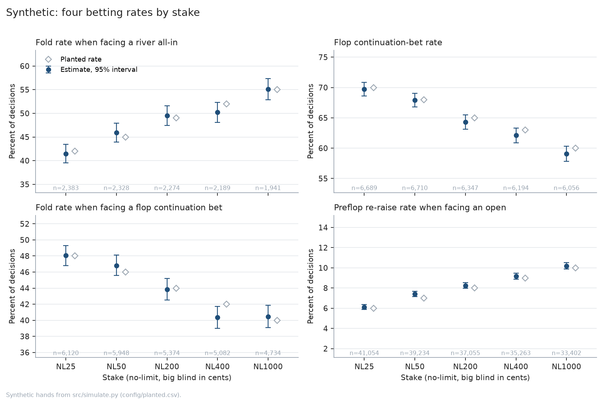

# pokermeta

Turns poker hand histories into two tidy tables and measures betting tendencies by stake, with a confidence interval on every rate.

Hand histories record what happened, not what each player faced. Whether a fold was a fold to an all-in, or a bet was a continuation bet, depends on the pot, the stacks and every action before it. The source used here is 21.6 million anonymized online hands from July 2009, in the open PHH format, recorded in dollars at stakes from $0.25 to $10 big blinds.

## Run it

The quickest path uses synthetic hands (no download, about a minute):

```
python -m venv .venv && .venv/bin/pip install -r requirements.txt
.venv/bin/python src/simulate.py --hands 20000 --out data/synthetic
.venv/bin/python src/phh_to_parquet.py --data data/synthetic --out out --glob '**/*.phhs' --site Synthetic
.venv/bin/python src/report.py --out out --site Synthetic --planted config/planted.csv
```

```
parse errors: 0 of 100,000 hands (0.00%) -> out/qa/parse_errors.csv
-> out/report/2026-10-30/stakes.png, stakes.md
```

For the real data, download and unzip the dataset (about 20 GB, link below) into `data/`, then:

```
.venv/bin/python src/phh_to_parquet.py --data data --out out --glob '**/*.phhs'
.venv/bin/python src/build_db.py --out out --db out/pokermeta.db
.venv/bin/python src/report.py --out out/pokermeta.db --site PokerStars --seats 6
```

Parsing runs at about 900 hands a second per core; the whole set is 6–7 core-hours.

## What comes out

- `out/hands/*.parquet`: one row per hand (site, stake, players, board, how far it went, showdown).
- `out/actions/*.parquet`: one row per voluntary decision, with what the player faced (amount to call, pot, bet size as a share of the pot, whether the bettor was all-in, continuation-bet flags).
- `out/qa/parse_errors.csv`: every hand that wouldn't replay, with its file, position and error.
- `out/report/<date>/`: the figure below and a table of every rate with its interval and sample size.



On synthetic data the open diamonds are the rates planted in `config/planted.csv`. Every estimate should cover its diamond; that is the pipeline's main test.

`codebook.md` defines every field and statistic exactly, for example which decisions count as "facing a river all-in". Read it before using a number.

## Why it's built this way

- **Hands are replayed, not re-derived.** Each hand runs through PokerKit's own game engine, and the pot, bet faced and all-in status are read from the engine's state at each decision. Hand-written pot arithmetic is where trackers usually go wrong.
- **Every rate is a proportion with a Wilson interval and its n.** River all-ins are rare, so cells get thin quickly when split by stake or site.
- **Synthetic hands with known answers.** `simulate.py` plays hands through the same engine with each decision drawn from a planted rate, writes them in dollars like the real files, and the test suite checks that the stat panel finds each rate. A five-hand fixture with hand-computed answers checks the field logic.
- **A dropped hand is never silent.** It goes to `qa/parse_errors.csv`, and the run fails if more than 0.5% of hands are dropped. An earlier version caught every per-hand error and skipped the hand quietly. Dollar amounts below $1 then crashed the bet-size calculation, so every low-stakes hand with a bet in it disappeared. The stakes that survived looked plausible and the 18 fixture checks passed, because the fixture used whole chips. The synthetic test now catches that bug.
- **Money is converted to float in one place.** PokerKit keeps dollar amounts as `Decimal` and chip amounts as `int`; mixing them caused the bug above.
- **"Players dealt in", not "6-max".** The files record how many players were dealt cards, not the table size, so the report says what it can know.
- **Parquet shards, then one DuckDB file.** One shard per input file keeps memory bounded during parsing; `build_db.py` then makes a single file so queries take milliseconds instead of opening 20,000 shards.
- **Site comes from the file path.** The PHH records don't name the site, so it's read from the dataset's folder and file names, only within the data folder.

## Limits

- One month of 2009: a level, not a trend. Comparing years needs matched later samples of the same site, stake and table size.
- Position labels assume seat 1 is the small blind; check them before using position cuts.
- The showdown rate is per hand (did the hand reach showdown), not per player.
- The synthetic players act on coin flips, not hand strength. They test the pipeline; they say nothing about how people play.

## Data and license

Code: MIT. Real data: Kim, J. (2024). *A Dataset of Poker Hand Histories*. Zenodo. https://doi.org/10.5281/zenodo.13997158, licensed [CC BY 4.0](https://creativecommons.org/licenses/by/4.0/). The hands were anonymized by the original source; this repository does not include them. It parses them into tables and summary statistics, which are derived from but not part of the dataset. Not affiliated with the dataset's authors or with any poker site.
