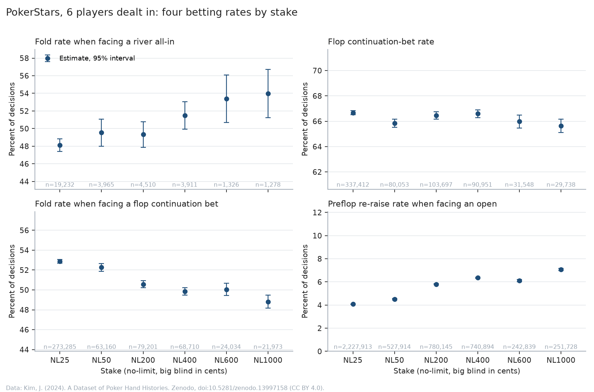

# poker-stakes-pipeline

Turns millions of poker hand histories into tidy tables and measures how betting changes with stakes.



The source is 21.6 million anonymized online hands from July 2009 in the open PHH format. Hand histories record what happened, not what each player faced: whether a fold was a fold to an all-in, or a bet was a continuation bet, depends on the pot, the stacks and every action before it. This replays every hand to recover that, then reports each rate with a confidence interval.

## What it found

PokerStars, hands with six players dealt in, 2.3 million hands from $0.25 to $10 big blinds:

| Rate | NL25 | NL1000 |
|---|---:|---:|
| Re-raise an open | 4.1% | 7.1% |
| Fold to a flop continuation bet | 52.9% | 48.8% |
| Fold facing a river all-in | 48.1% | 54.0% |
| Make a flop continuation bet | 65.6% to 66.7% at every stake | |

Higher-stakes players re-raise more, fold less to a continuation bet, and fold more when facing a river all-in. The intervals at the two ends don't overlap for any of the three. This is one site and one month: a level, not a cause.

## Run it

The quick path uses simulated hands (no download, about a minute):

```
python -m venv .venv && .venv/bin/pip install -r requirements.txt
.venv/bin/python src/simulate.py --hands 20000 --out data/synthetic
.venv/bin/python src/phh_to_parquet.py --data data/synthetic --out out --glob '**/*.phhs' --site Synthetic
.venv/bin/python src/report.py --out out --site Synthetic --planted config/planted.csv
```

For the real data, download the dataset (about 20 GB, link below) into `data/`, then run `phh_to_parquet.py`, `build_db.py` and `report.py` on it. All 21.6 million hands parse in about 30 minutes on 10 cores; the 755 hands that are broken in the source go to a QA file.

Out come Parquet tables of hands and decisions (with the pot, the bet faced and continuation-bet flags), a DuckDB file, the QA file, and the chart and rate table above. `codebook.md` defines every field.


## Why it's built this way

- **Hands are replayed, not re-derived.** Each hand runs through PokerKit's game engine and the pot and bet faced are read from its state. Hand-written pot math is where trackers usually go wrong.
- **Simulated hands with planted rates.** The test suite checks the pipeline finds each one (the diamonds above).
- **A dropped hand is never silent.** It's logged, and the run fails if more than 0.5% are dropped. An early version quietly lost every low-stakes hand with a bet in it; this is the check that now catches that.
- **Every rate comes with a Wilson interval and its sample size.** River all-ins are rare, so cells get thin fast.
- **Parquet shards, then one DuckDB file.** Shards keep memory bounded while parsing; one file keeps queries fast.

## Limits

- One month of 2009. Comparing years needs matched later samples.
- The files record players dealt in, not table size.
- Position labels assume seat 1 posts the small blind (true for 99.7% of a 300-file sample).

Code: MIT. Data: Kim, J. (2024). *A Dataset of Poker Hand Histories*. Zenodo. https://doi.org/10.5281/zenodo.13997158, [CC BY 4.0](https://creativecommons.org/licenses/by/4.0/). The hands aren't included here; only derived tables and statistics. Not affiliated with the dataset's authors or any poker site.
